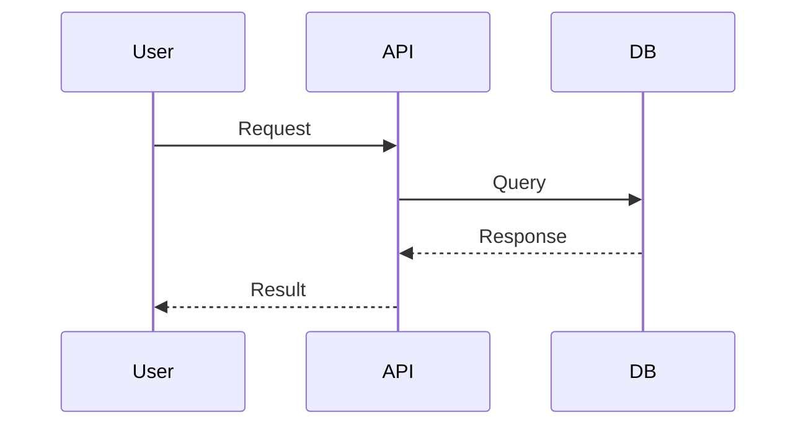

# ProjectPulse Dashboard: AI-Powered Project Management

ProjectPulse Dashboard is an innovative, AI-powered project management solution designed to enhance team productivity, automate status tracking, and bridge the gap between complex project data and actionable insights. By integrating secure backend integrations with a conversational AI interface, it allows developers, managers, and non-technical stakeholders to query project metrics, sprint progress, and task details in natural language.

Developed by **Vibhav Sharma** in partial fulfillment of the requirements for the M.Sc. Computer Application degree at **Symbiosis Institute of Computer Studies and Research (SICSR)**, Pune, March 2026.

---

## 🔍 The Problem Solved

Traditional project tracking tools (such as Jira, Asana, or Monday.com) are powerful but present several persistent operational challenges:

1. **Information Overload**: Project spaces accumulate huge volumes of issues, sprints, and metrics. Stakeholders struggle to filter through the noise to locate critical tasks or bottleneck indicators.
2. **Complex Navigation**: Accessing specific project statuses requires knowing custom query languages (like Jira's JQL) or clicking through complex, deep-nested UI dashboard configurations.
3. **Lack of Actionable Insights**: Standard dashboards show charts but do not synthesize trends, flag timeline risks, or offer text-based summaries automatically.
4. **Accessibility Barriers**: Non-technical team members, client-side stakeholders, and product owners often find standard developer-focused interfaces intimidating and confusing.
5. **Security Risks in AI Integrations**: Exposing API tokens directly to client browsers or passing raw project history to public third-party AI interfaces risks leaking sensitive intellectual property and credentials.

### How ProjectPulse Addresses These Issues:
- **Natural Language Querying**: Eliminates the complex query and click barrier. Users can simply ask: *"Who is currently assigned to critical tickets?"* or *"Summarize the issues blocking our sprint."*
- **Secure Server-Side Architecture**: Keeps Jira API tokens and credentials isolated on the Django backend. No API keys are sent to the client browser.
- **Intelligent Context Grounding**: The backend implements an **AI Context Building Algorithm** that parses data sources (synced Jira issues or custom CSV uploads), extracts schema headers, and structures the top 80 rows into a compact Markdown table. This creates a focused system prompt payload for the LLM that complies with token constraints, avoids token cost bloating, and prevents AI hallucinations.
- **Unified CSV/Jira Tracking**: Supports direct Jira syncing or standard spreadsheet (CSV) uploads, letting teams aggregate metrics regardless of whether they use custom sheets or enterprise Jira workflows.

---

## 🛠️ Tech Stack

ProjectPulse is built on a modern, decoupled architecture:

### Frontend
- **Framework**: React 18 + Vite (Fast development and build pipeline)
- **Language**: TypeScript / JavaScript
- **Styling**: Tailwind CSS (Utility-first framework) + Shadcn UI components
- **Animations**: Framer Motion (Smooth, responsive glassmorphic transitions)
- **Data Fetching**: Axios & React Query (Optimized caching and synchronization)
- **Charts/Visualization**: Recharts (Dynamic status distributions, bar charts, and sprint velocity displays)
- **Icons**: Lucide React

### Backend
- **Framework**: Django 4.2+ (Python 3.11)
- **API Engine**: Django REST Framework (DRF)
- **Authentication**: JWT (JSON Web Tokens via simplejwt)
- **Database**: SQLite (local development) / PostgreSQL (production architecture)
- **AI Integration**: Groq API Client (utilizing the `llama-3.3-70b-versatile` LLM model for high-speed, analytical responses)
- **Jira Integration**: Atlassian Jira REST API v3 (utilizing the `jira` Python package)

---

## 🏗️ System Architecture

The following diagram illustrates how the frontend React app, the Django backend, Jira servers, and the Groq AI service securely interact:
## System Architecture


## Sequence Diagram



## 📂 Project Structure

```text
ProjectPulse/
├── projectpulse-dashboard/
│   ├── backend/             # Django REST Framework Application
│   │   ├── chat/            # Chat Sessions, Messages & Groq AI utilities
│   │   ├── datasets/        # CSV Dataset uploads and models
│   │   ├── integrations/    # Jira sync connectors and task caching
│   │   ├── projects/        # Project model structures
│   │   ├── users/           # Custom User authentication logic
│   │   ├── projectpulse/    # Main settings, URLs, and WSGI entry points
│   │   └── manage.py        # Django project administrator executable
│   │
│   ├── frontend/            # React + Vite Client Application
│   │   ├── src/
│   │   │   ├── components/  # Nav bars, sidebars, and protected route routes
│   │   │   ├── pages/       # Login, Signup, Chat console, Upload, and Analytics boards
│   │   │   ├── lib/         # API request utilities and authentication wrappers
│   │   │   ├── hooks/       # Custom React state hooks
│   │   │   └── App.jsx      # Main application router
│   │   ├── package.json
│   │   └── tailwind.config.js
│   │
│   ├── schema.sql           # Database schema definition for PostgreSQL compatibility
│   └── README.md            # App-level README
```

---

## ⚙️ Getting Started & Installation

### Backend Setup (Django)

1. **Navigate to the Backend Directory**:
   ```bash
   cd projectpulse-dashboard/backend
   ```

2. **Create and Activate a Virtual Environment**:
   ```bash
   # On macOS/Linux
   python3 -m venv venv
   source venv/bin/activate

   # On Windows (PowerShell)
   python -m venv venv
   .\venv\Scripts\Activate.ps1
   ```

3. **Install Dependencies**:
   ```bash
   pip install -r requirements.txt
   ```

4. **Configure Environment Variables**:
   Create a `.env` file in `projectpulse-dashboard/backend/` and configure the following variables:
   ```env
   SECRET_KEY=your-django-secret-key-here
   DEBUG=True
   ALLOWED_HOSTS=localhost,127.0.0.1
   GROQ_API_KEY=your-groq-api-key-here
   ```

5. **Run Database Migrations**:
   SQLite is used by default for local development. Initialize the database schema:
   ```bash
   python manage.py makemigrations
   python manage.py migrate
   ```

6. **Start the Django Server**:
   ```bash
   python manage.py runserver
   ```
   The backend API endpoints will be accessible at `http://127.0.0.1:8000/api/`.

---

### Frontend Setup (React)

1. **Navigate to the Frontend Directory**:
   ```bash
   cd projectpulse-dashboard/frontend
   ```

2. **Install Dependencies**:
   ```bash
   npm install
   # OR if using Bun
   bun install
   ```

3. **Configure Frontend Environment** (Optional):
   Create a `.env` file inside `projectpulse-dashboard/frontend/` if you want to override the backend API URL:
   ```env
   VITE_API_URL=http://localhost:8000/api
   ```

4. **Launch the Vite Development Server**:
   ```bash
   npm run dev
   # OR if using Bun
   bun run dev
   ```
   The application dashboard will run locally at `http://localhost:5173`.

---

## 📈 Functional Verification & Usage

1. **Authentication**: Sign up a new user or log in at `http://localhost:5173/login`.
2. **Jira Integration**: Navigate to the **Jira** tab, fill out your Jira site URL (e.g. `https://your-domain.atlassian.net`), developer email, and Atlassian API token. Saving automatically fetches issue histories and creates a local dataset.
3. **Dataset Import**: Go to the **Upload** tab to import custom CSV files containing task headers (e.g. key, summary, priority, status).
4. **Interactive Dashboard**: Use the **Projects** tab to view beautiful visual status bars, issue breakdown matrices, priority counts, and task distributions.
5. **AI Chat Console**: Visit the main **Chat** view to query project health, generate sprint summaries, or analyze team load. The system prompt will automatically context-ground queries using your latest data.

---

## 🎓 License and Academic Context
This software was developed by Vibhav Sharma in 2026 as a final dissertation project for the degree of M.Sc. Computer Application at SYMBIOSIS INSTITUTE OF COMPUTER STUDIES AND RESEARCH (SICSR), Symbiosis International (Deemed University).
All code is provided for educational evaluation, research review, and implementation demonstration purposes.
